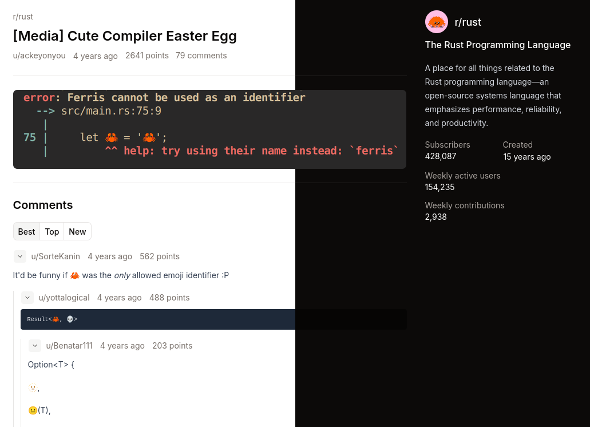

# lurklet

A private, read-only, lightweight, front-end for Reddit, built from scratch in Rust.



## Goals

- Be a privacy-optimized Reddit front-end - minimize data exposure and usage tracking.
- Be resilient - design with replaceable transports and minimize upstream coupling.
- Be a responsible net-citizen - resist automated scraping, disallow indexing, minimize Reddit load.
- Be secure in a hostile Internet - use modern security standards.

## Features

- Mimics the Reddit URL style - just change the origin (use your favorite redirect extension).
- Viewing subreddits, posts, and comments.
- Mobile. (this is a feature these days?)
- Proxies supported media through the server (images).
- Built-in rate-limiting - with basic protections against flood attacks and scraping.
- Search-indexing disallowed.
- Sane caching by default - designed to operate behind a CDN/Caching proxy.
- A11y by default (let me know how this can be improved).
- Dark/light mode by default.
- Attempts to mimic real devices, including resisting TLS fingerprinting.
- Reasonable security - restrictive Content Security Policy, mime-sniffing disallowed, XSS protections, resource usage is constrained by design, tested under restricted container defaults (read-only filesystem, non-root runtime user, etc.).
- Proxy support (SOCKS5 and HTTP/HTTPS).
- Distroless-based image - minimal, no package managers, no shells, etc.
- Also QOL features like built-in health checking, response compression, and session caching.

## Usage

Starting `lurklet` with no parameters will serve the app on port `3000`.

```bash
docker run \
    -p 127.0.0.1:3000:3000 \
    ghcr.io/silvenga/lurklet:latest
```

A sane docker-compose.yaml could look like:

```yaml
services:
  lurklet:
    image: ghcr.io/silvenga/lurklet:latest
    ports:
      - "127.0.0.1:3000:3000"
    security_opt:
      - no-new-privileges:true
    cap_drop:
      - ALL
    read_only: true
    volumes:
      - cache:/cache
volumes:
  cache:
```

> By default, a `--state-file` persists the last anonymous session and a generated instance id. This allows for frequent restarts without appearing to generate a lot of anonymous sessions for your IP. So understand the privacy trade offs - a more stable anonymous identifier vs possible network ip-bans.

For usage, pass `--help`.

```
The lurklet API server

Usage: lurklet-api [OPTIONS] [COMMAND]

Commands:
  export-openapi  Write the internal OpenAPI document to stdout without starting the server
  health-check    Check the local API's HTTP status without reading its response body
  help            Print this message or the help of the given subcommand(s)

Options:
      --bind <BIND>
          Address on which to serve HTTP [env: LURKLET_BIND=0.0.0.0:3000] [default: 127.0.0.1:3000]
      --static-dir <STATIC_DIR>
          Directory containing the built website [env: LURKLET_STATIC_DIR=/app/static] [default: lurklet-api/static]
      --cache-dir <CACHE_DIR>
          Save a persistent API response cache (cache-on-error) [env: LURKLET_CACHE_DIR=/cache]
      --api-cache-max-age-seconds <API_CACHE_MAX_AGE_SECONDS>
          How long to cache successful API data and media responses [env: LURKLET_API_CACHE_MAX_AGE_SECONDS=] [default: 3600]
      --state-file <STATE_FILE>
          Restore and save Reddit session state across restarts [env: LURKLET_STATE_FILE=/cache/state.json]
      --proxy <URL>
          Proxy for Reddit requests (http, https, socks5, or socks5h) [env: LURKLET_PROXY]
      --reddit-request-timeout-seconds <REDDIT_REQUEST_TIMEOUT_SECONDS>
          Total upstream request timeout in seconds. -1 means no limit [env: LURKLET_REDDIT_REQUEST_TIMEOUT_SECONDS=] [default: -1]
      --rate-limit-rps <RATE_LIMIT_RPS>
          Sustained API requests per second per client (IPv6 is by /64) [env: LURKLET_RATE_LIMIT_RPS=] [default: 1]
      --rate-limit-burst <RATE_LIMIT_BURST>
          Maximum burst of API requests per client [env: LURKLET_RATE_LIMIT_BURST=] [default: 10]
      --client-ip-source <CLIENT_IP_SOURCE>
          Client-IP source [env: LURKLET_CLIENT_IP_SOURCE=] [default: peer] [possible values: peer, x-forwarded-for, x-real-ip]
      --trusted-proxies <TRUSTED_PROXIES>
          Trusted upstream proxies. Empty trusts all proxies [env: LURKLET_TRUSTED_PROXIES=]
  -h, --help
          Print help
  -V, --version
          Print version
```

## Planned Features

- Proxying videos - both MP4 and DASH based streams.
- RSS Feeds.
- Better support for Reddit markdown quirks (currently handles inline media and internal/external links).
- Alternative transports e.g., authenticated, desktop emulation, etc.
- Disk based perma caching (disabled by default).
- Programmatic access (disabled by default).
- Basic u/user support.

## Unsupported

- A "front page" of Reddit home page.
- Searching or content discovery.
- Subreddit Wikis.
- Alternative deployment types e.g., single binary.
- JS-disabled environments.
